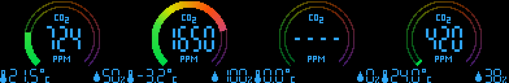

# CO2-Display

CO2-Wert, Temperatur und Luftfeuchtigkeit des **CO2-Sensors SCD40** auf dem
**0,95″-Farb-OLED SSD1331 (96×64)** für den **Calliope mini 3**.

Oben ein Bogen von 400 bis 2000 ppm (grün → gelb → rot → lila), in der Mitte der
CO2-Wert in ppm, unten links die Temperatur, unten rechts die Luftfeuchtigkeit.
Bis zum ersten Messwert (ca. 5 Sekunden) steht `----` in der Mitte.

## Anschluss

SCD40 an den I²C-Grove-Anschluss **A0**.

Das Farb-OLED wird per **SPI** angeschlossen (SCL/SDA am Display sind SPI, nicht I²C):

| Display | Calliope mini |
|---------|---------------|
| GND     | GND           |
| VCC     | 3V            |
| SCL     | C13 (SCK)     |
| SDA     | C15 (MOSI)    |
| RES     | P3            |
| DC      | C8            |
| CS      | C9            |

C14 frei lassen (wird als MISO vom SPI belegt). Andere Pins in `ssd1331.ts` einstellen.

## Verwendung

In [MakeCode für Calliope mini](https://makecode.calliope.cc) über **Importieren → Importiere URL**
die GitHub-URL dieses Projekts öffnen. Die Erweiterung
[CO2-Sensor-SCD40](https://github.com/calliope-edu/CO2-Sensor-SCD40) wird automatisch geladen.

## Dateien

* `main.ts` – Anzeige (Bogen, Siebensegment-Ziffern, Symbole) und Messschleife
* `ssd1331.ts` – Display-Treiber mit Bildpuffer (flackerfrei)
